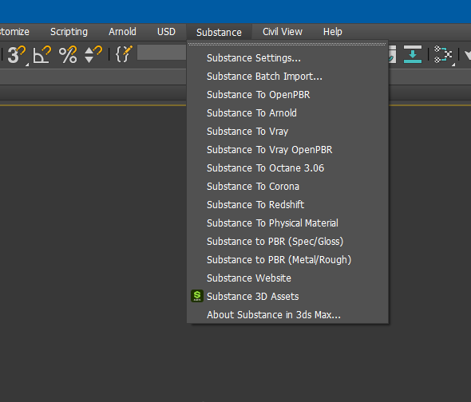

# Verwenden von Workflows im 3ds Max

Das Substance in 3ds Max-Plugin enthält Workflows zum automatischen Erstellen eines Shader-Netzwerks zur Unterstützung von Renderern. Die Render-Arbeitsabläufe finden Sie im Menü Substance .

Um einen Arbeitsablauf zu verwenden, wählen Sie den Substance-Knoten im Material-Editor aus und wählen Sie dann den Arbeitsablauf aus dem Substance-Menü.

## OpenPBR Workflows

Zwei OpenPBR-Workflows sind in der Liste **Workflows** im Menü **Substance verfügbar**: **Substance auf OpenPBR** und **Substance auf V-Ray OpenPBR**. Diese Arbeitsabläufe wurden für die Verwendung mit SBSAR-Dateien entwickelt, die mit dem OpenPBR-Materialmodell in Substance 3D Designer oder Sampler erstellt wurden (OpenPBR ist seit Designer V16.0+ und Sampler V6.0+ das Standardmodell).

### Was ist OpenPBR?

OpenPBR ist ein offenes, physikalisch basiertes Material-Schattierung-Modell, das von Adobe und Autodesk entwickelt wurde und an der Academy Software Foundation (ASWF) mitwirkte. Es bietet eine einheitliche Material-Definition, die mit allen Renderern kompatibel ist. Weitere Informationen finden Sie in der [OpenPBR-Dokumentation](https://experienceleague.adobe.com/de/docs/substance-3d/general-knowledge/openpbr/openpbr-overview).

### Wann sollte ein OpenPBR-Arbeitsablauf verwendet werden?

Verwenden Sie einen OpenPBR-Arbeitsablauf, wenn Ihre Sbsar-Dateien über das OpenPBR-Materialmodell in Substance 3D Designer oder Substance 3D Sampler erstellt wurden. Wenn Ihre SBSAR-Datei mit Adobe Standard Materialmodell (ASM) erstellt wurde, verwenden Sie den älteren Arbeitsablauf, der mit Ihrem Renderer kompatibel ist (Arnold, V-Ray oder V-Ray 6).

>[!NOTE]
>
> Wenn Sie einen OpenPBR-Workflow auf ein ASM-Material oder einen Standardarbeitsablauf auf ein OpenPBR-SBSAR anwenden, verbindet das Plug-In nur Ausgaben, die beiden Materialmodellen gemeinsam sind. Das Ergebnis ist möglicherweise unvollständig.

### Verfügbare OpenPBR-Workflows

**OpenPBR**

Verwendet den nativen 3ds Max openPBRSurface-Knoten. Kompatibel mit Arnold und V-Ray. Dies ist der empfohlene Arbeitsablauf für die meisten Benutzer, die mit OpenPBR-Materialien in 3ds Max arbeiten.

**OpenPBR - V-Ray**

Verwendet das V-Ray-Material (VRayMtl) im OpenPBR-Modus. Empfohlen für Benutzer, deren Pipeline speziell um V-Ray-Material-Setups herum aufgebaut ist.

### Anwenden eines OpenPBR-Workflows

1. Wählen Sie Ihre Sbsar-Datei (OpenPBR) mit der Schaltfläche Substance laden aus.
1. Wählen Sie im oberen Menü OpenPBR oder OpenPBR - V-Ray aus.
1. Klicken Sie auf Netzwerk erstellen, um das Shader-Netzwerk im Slate Material Editor zu erstellen.
1. Das Plug-in verbindet die SBSAR-Ausgänge automatisch mit den entsprechenden Eingängen des OpenPBR-Nodes.
1. Weisen Sie das Material wie gewohnt Ihrem Mesh zu.

