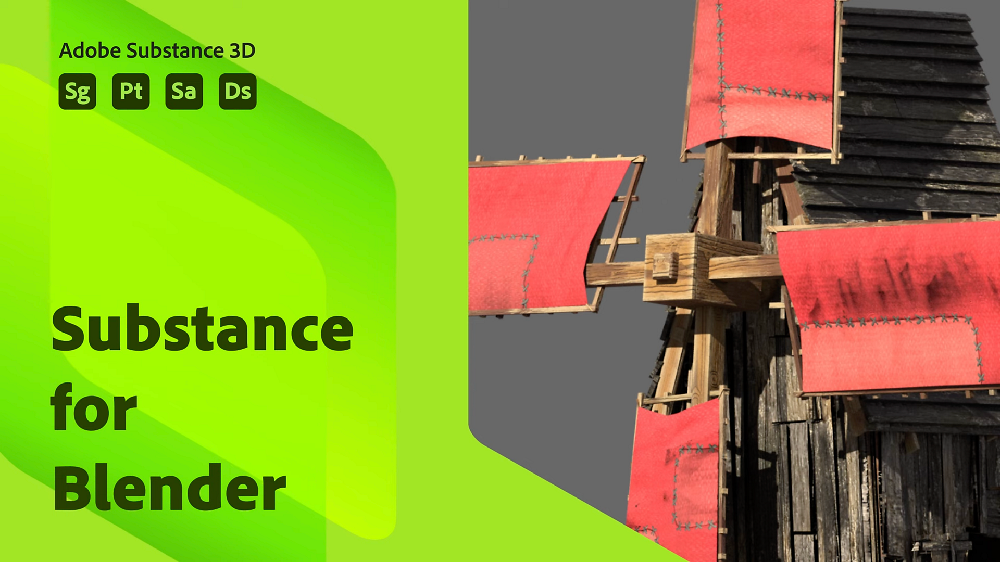

# Mixer

## Inhaltsverzeichnis

* [Substance in Blender - Übersicht](../../3d-applications/blender/in-blender-overview/substance-in-blender-overview.md)
* [Herunterladen und Installieren des Plug-ins](../../3d-applications/blender/downloading-and-ins/downloading-and-installing-the-plugin.md)
* [Voreinstellungen](../../3d-applications/blender/preferences/preferences.md)
* [Das Bedienfeld &quot;Substance 3D&quot;](../../3d-applications/blender/the-3d-panel/the-substance-3d-panel.md)
* [Tastaturbefehle und Navigation](../../3d-applications/blender/shortcuts-and-navigation/shortcuts-and-navigation.md)
* [Workflows](../../3d-applications/blender/workflows/workflows.md)
* [Physische Größe in Blender](../../3d-applications/blender/physical-size-in-blender/physical-size-in-blender.md)
* [Substance 3D Assets Library](../../3d-applications/blender/3d-assets-library/substance-3d-assets-library.md)
* [Fehlerbehebung](../../3d-applications/blender/troubleshooting/troubleshooting.md)
* [Deinstallieren des Add-ons](../../3d-applications/blender/uninstalling-the-add-on/uninstalling-the-add-on.md)
* [Substance 3D-Add-on für Blender-Tutorials](../../3d-applications/blender/add-for-blender-tutorials/substance-3d-add-on-for-blender-tutorials.md)
* [Versionshinweise](release-notes/release-notes.md)
