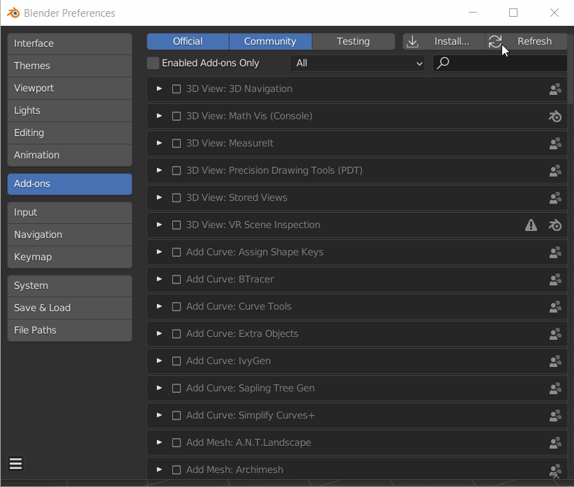

# Herunterladen und Installieren des Plug-ins

## Herunterladen

Besuchen Sie [Substance 3D in Blender](https://substance3d.adobe.com/plugins/substance-in-blender/), um das Plug-in herunterzuladen. Klicken Sie auf **Plug-in herunterladen**, um den Download zu starten.

Sie können die neueste Version auch direkt über die folgenden Links erhalten.

Es gibt zwei separate ZIP-Dateien zum Herunterladen und Installieren:

* Substance 3D-Add-on für Blender ([einzelner Download für alle Plattformen](https://www.adobe.com/go/substance3d-blender-multi-latest))
* Substance 3D-Integrationstools (Herunterladen von [Windows](https://www.adobe.com/go/substance3d-integrationtools-win-latest), [Mac](https://www.adobe.com/go/substance3d-integrationtools-mac-latest) oder [Linux](https://www.adobe.com/go/substance3d-integrationtools-lin-latest) Versionen)

>[!WARNING]
>
> **Für Mac-Benutzer:** *Benutzer sollten &quot;Sichere Dateien nach dem Herunterladen öffnen&quot; deaktivieren, wenn sie das Plug-in mit Safari herunterladen.*
>
> Safari-Webbrowser entpackt standardmäßig heruntergeladene ZIP-Dateien, die für die Installation gezippt bleiben müssen. Um zu verhindern, dass die Datei entpackt wird, aktualisieren Sie die Safari-Einstellungen, sodass &quot;sichere&quot; Dateien nach dem Herunterladen nicht geöffnet werden.
>
> 1. Safari öffnen
> 1. Klicken Sie auf **Voreinstellungen**.
> 1. Deaktivieren Sie auf der Registerkarte Allgemein die Option **Öffnen Sie &quot;sichere&quot; Dateien nach dem Herunterladen.**

## Installationsschritte

### Erstmalige Installation

1. Laden Sie die ZIP-Dateien des Plug-ins von der Prerelease-Seite für Adobe herunter.
1. Blender öffnen (v. 3.0 oder höher).
1. Wählen Sie in der oberen Navigationsleiste Bearbeiten und dann Voreinstellungen aus. Wählen Sie dann die Registerkarte Add-ons aus.
1. Klicken Sie auf die Schaltfläche **Installieren**.
1. Suchen Sie im Dateiordner den Explorer, in den die ZIP-Dateien heruntergeladen wurden
1. Wählen Sie die Datei Substance3DInBlender.zip aus und klicken Sie auf die Schaltfläche **Add-on installieren**.
1. Klicken Sie im Abschnitt Add-ons auf das Kontrollkästchen, um das Add-on zu aktivieren, und klicken Sie auf den Dropdown-Pfeil, um den Abschnitt zu erweitern.
1. Sie werden aufgefordert, die Integrationstools zu installieren. Klicken Sie auf **Von Datenträger installieren**, um **Substance3DIntegrationTools.zip** auszuwählen, und klicken Sie auf die Schaltfläche **Tools installieren**.\
   Wenn sie nicht zuvor heruntergeladen wurden, klicken Sie auf **Herunterladen**, um die Adobe-Prerelease-Seite in Ihrem Browser zu öffnen und die Tools herunterzuladen. Verwenden Sie dann **Von Festplatte installieren**, um sie zu installieren.
1. Das Add-on kann jetzt verwendet werden!

### Plug-in und Tools aktualisieren

1. Laden Sie die neueste Version von den oben genannten Links herunter.
1. Verwenden Sie die Schaltfläche **Tools deinstallieren**, um die Substance 3D Integration Tools zu entfernen.
1. Verwenden Sie die Schaltfläche **Entfernen**, um das Add-on zu deinstallieren.
1. Blender schließen und neu starten
1. Wählen Sie in der oberen Navigationsleiste Bearbeiten und dann Voreinstellungen aus. Wählen Sie dann die Registerkarte Add-ons aus.
1. Klicken Sie auf die Schaltfläche **Installieren**.
1. Suchen Sie im Datei-Explorer die neu heruntergeladenen ZIP-Dateien.
1. Wählen Sie die Datei Substance3DInBlender.zip aus und klicken Sie auf die Schaltfläche **Install** Add-on.
1. Klicken Sie im Abschnitt Add-ons auf das Kontrollkästchen, um das Add-on zu aktivieren, und klicken Sie auf den Dropdown-Pfeil, um den Abschnitt zu erweitern.
1. Sie werden aufgefordert, die Integrationstools zu installieren. Klicken Sie auf **Von Datenträger installieren**, um die Datei Substance3DIntegrationTools.zip auszuwählen, und klicken Sie auf die Schaltfläche **Tools installieren**.\
   Wenn sie nicht zuvor heruntergeladen wurden, klicken Sie auf **Herunterladen**, um die Adobe-Prerelease-Seite in Ihrem Browser zu öffnen und die Tools herunterzuladen. Verwenden Sie dann **Von Festplatte installieren**, um sie zu installieren.
1. Das Add-on kann jetzt verwendet werden!

### Einzelne Komponenten aktualisieren

Nur beim Aktualisieren des Add-ons:

1. Verwenden Sie in den Add-On-Voreinstellungen die Schaltfläche **Entfernen**, um das Add-On zu deinstallieren.
1. Mixer neu starten
1. Navigieren Sie erneut zu den Add-On-Einstellungen und verwenden Sie die Schaltfläche **Installieren**, um die neue Version des Plug-ins zu laden. Die zuvor geladenen Integrationstools bleiben erhalten.

Nur beim Aktualisieren der Integrationstools:

1. Verwenden Sie in den Add-On-Voreinstellungen die Schaltfläche **Update Tools**, um die neuere Version der Integrationstools zu laden. Das zuvor verwendete Add-on bleibt erhalten.
1. Starten Sie Blender neu, damit die Änderungen wirksam werden.

ODER

1. Verwenden Sie in den Add-On-Voreinstellungen die Schaltfläche **Tools deinstallieren**, um die Integrationstools zu entfernen.
1. Mixer neu starten
1. Verwenden Sie die Schaltfläche **Von Datenträger installieren**, um die neuere Version der Integrationstools zu suchen und zu laden. Das zuvor verwendete Add-on bleibt erhalten.