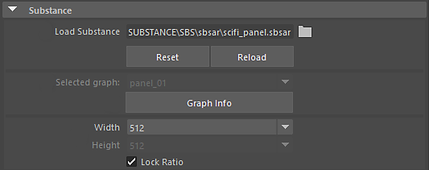

# Substance in Maya - Übersicht

## Übersicht über Plug-ins

Mit dem Plug-in &quot;Substance für Maya&quot; können Sie jedes vorhandene Substance 3D-Material (.Sbsar-Datei) direkt in Maya laden. Substance 3D-Materialien können als SBSAR-Dateien aus Substance 3D Designer oder Substance 3D Sampler erstellt und exportiert sowie aus bestehenden Bibliotheken (z. B. der Substance 3D Assets Library) heruntergeladen werden. Das Substance für Maya-Plug-in erstellt Maya-Material und übergibt die Texturen an die richtigen Material-Kanaleingänge.

>[!NOTE]
>
> Stellen Sie sicher, dass Sie das Plug-in unter Einstellungen/Voreinstellungen ->Maya Plug-in Manager geladen haben.

## Öffnen einer Sbsar-Datei im Hypershade-Node-Editor

1. Öffnen Sie **Hypershade**, und klicken Sie im **Node Editor** mit der rechten Maustaste auf den Knoten, und wischen Sie im Markierungsmenü nach oben, um **Knoten erstellen** auszuwählen. Suchen Sie im Fenster **Knoten erstellen** nach dem Knoten **Substance** und wählen Sie ihn aus.

   

   Klicken Sie auf den **Substance-Knoten** in Hypershade, um ihn auszuwählen. Dadurch wird der **Materialien-Editor** geöffnet, in dem Sie Ihr Substance 3D-Material (Sbsar-Dateien) laden können, indem Sie auf das Ordnersymbol klicken.

1. Alternativ können Sie eine Sbsar-Datei per Drag &amp; Drop in Mayas **Hypershade-Editor** ziehen und auf den automatisch erstellten Substance-Knoten klicken, um Optionen direkt im **Material-Editor** anzuzeigen und zu bearbeiten.

### Mit SBSAR-Parametern im Eigenschaften-Editor experimentieren

1. Das Dropdown-Menü **Ausgewählter Graf** wird aufgefüllt, wenn die Substance mehrere Graf enthält. Wählen Sie den Graf aus, der zum Erstellen des Materials verwendet werden soll.

1. Die Schaltfläche **Graf-Info** zeigt die im Substance Designer festgelegten Graf-Attribute an.

1. Legen Sie die Auflösung fest, indem Sie die Werte **Width** und **Height** festlegen. Deaktivieren Sie **Sperrverhältnis**, um nicht quadratische Verhältnisse auszuwählen.

1. Aktivieren Sie **Cacheausgaben auf Datenträger**, um die Substance-Ausgaben auf den Datenträger Baking führen, damit sie mit Renderern wie Arnold verwendet werden können. Die zwischengespeicherte Datei wird vom Plugin über einen Maya-Dateiknoten wieder eingelesen.

   

1. Wählen Sie einen Arbeitsablauf für den verwendeten Renderer aus und klicken Sie auf die Schaltfläche **Shader-Netzwerk erstellen**. Für den Renderer-Workflow wird ein Shader-Netzwerk erstellt. Für die Versionen 3.1.1. bietet die Liste der Arbeitsabläufe auch die Möglichkeit, OpenPBR-Shader-Netzwerke zu erstellen. Sobald das Shader-Netzwerk erstellt wurde, können Sie das Material in der Szene anwenden.

   {width="1000px"}

## Fehlerbehebung

Um einen Fehler zu melden, nehmen Sie am #maya-plugin auf dem [Substance Discord-Server](https://discord.com/invite/substance3d) teil oder besuchen Sie [Adobe Communities](https://community.adobe.com/t5/substance-3d-plugins/ct-p/ct-substance-3d-plugins?page=1&sort=latest_replies&lang=all&tabid=all&topics=label-autodesk3dsmax). Durch die Aufnahme relevanter Informationen aus dem Konsolenprotokoll und etwaiger Wiedergabeschritte können wir das Problem effizienter diagnostizieren.